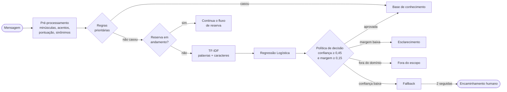

# Maresia — a assistente virtual do Tempero Açoriano

[](https://github.com/LucasdaCosta04/maresia-chatbot/actions/workflows/testes.yml)


A **Maresia** é a assistente virtual do **Tempero Açoriano**, um restaurante fictício de frutos do mar em
Santo Antônio de Lisboa, Florianópolis/SC. Ela responde dúvidas sobre o cardápio, faz reservas e informa
horário e localização, usando um classificador de intenções treinado com scikit-learn e uma base de
conhecimento em JSON.

Projeto desenvolvido para a **A3 | Projeto Integrador de Inteligência Artificial**.


---

## O que a Maresia faz

### Intenções de domínio

| Intenção | O que cobre | Exemplos de mensagem |
|---|---|---|
| **Cardápio e alergênicos** | Pratos, preços, opções sem glúten/lactose, presença de crustáceos e outros alergênicos | "Vocês têm sequência de camarão?", "A moqueca leva leite de coco?" |
| **Reservas** | Fluxo guiado que coleta data, horário e número de pessoas e confirma a reserva | "Quero reservar uma mesa pra sábado", "Mesa para 4 às 20h" |
| **Horário e localização** | Dias e horários de funcionamento, endereço, estacionamento e como chegar | "Que horas vocês abrem domingo?", "Onde fica o restaurante?" |

### Quando a Maresia não tem certeza

- **Esclarecimento:** quando duas intenções ficam próximas, a Maresia pergunta qual delas a pessoa quis dizer
  em vez de chutar.
- **Fallback:** quando a confiança do modelo é baixa, ela diz que não entendeu e sugere os assuntos que sabe
  responder.
- **Abstenção para fora do escopo:** perguntas que não têm relação com o restaurante (política, clima,
  programação, outros estabelecimentos…) são recusadas com educação. Ela não inventa resposta.
- **Encaminhamento humano:** depois de **2 mensagens seguidas sem entender**, a Maresia oferece contato com
  um atendente humano. O contador volta a zero assim que uma mensagem é entendida.

---

## Como a IA funciona



1. **Pré-processamento:** a mensagem é normalizada (minúsculas, remoção de acentos e pontuação, sinônimos)
   para que "Vcs abrem domingo??" e "voces abrem domingo" fiquem iguais para o modelo.
2. **Regras prioritárias:** padrões objetivos (saudação, agradecimento, pedido explícito de atendente)
   são resolvidos antes do modelo, com resposta determinística.
3. **Reserva em andamento:** se há uma reserva sendo preenchida, a mensagem é lida como resposta ao passo
   atual (data, horário, pessoas). As entidades são extraídas sem passar pelo classificador.
4. **Classificador:** dois vetorizadores TF-IDF, um de **palavras** e outro de **n-gramas de caracteres**
   (este tolera erros de digitação), alimentam uma **Regressão Logística** que devolve a probabilidade de
   cada intenção.
5. **Política de decisão:** a intenção só é aceita se a **confiança for ≥ 0,45** *e* a **margem** para a
   segunda colocada for **≥ 0,15**. Caso contrário, a Maresia pede esclarecimento, se abstém ou cai no
   fallback.
6. **Resposta:** a intenção aceita é respondida a partir da base de conhecimento.

### Onde está cada parte no código

| Etapa | Arquivo | Responsabilidade |
|---|---|---|
| Pré-processamento | `chatbot/preprocessamento.py` | Normalização do texto, remoção de acentos e pontuação, sinônimos |
| Classificador | `chatbot/modelo.py` | TF-IDF (palavras + caracteres), Regressão Logística, treino, salvamento e carga |
| Entidades | `chatbot/entidades.py` | Extração de data, horário e número de pessoas para reservas |
| Base de conhecimento | `chatbot/conhecimento.py` | Leitura da base e montagem das respostas por intenção |
| Dados | `dados/base_conhecimento.json` | Intenções, frases de treino e respostas (editável sem mexer no código) |
| Diálogo | `chatbot/dialogo.py` | Regras prioritárias, estado da reserva, política de decisão, fallback e encaminhamento |
| Configuração | `chatbot/config.py` | Limiares e parâmetros ajustáveis |

---

## Como executar

### Pré-requisitos

- **Python 3.10+**
- Git

### Instalação

**Windows (PowerShell)**

```powershell
git clone https://github.com/LucasdaCosta04/maresia-chatbot.git
cd maresia-chatbot
python -m venv .venv
.\.venv\Scripts\Activate.ps1
pip install -r requirements.txt
```

**Linux / macOS**

```bash
git clone https://github.com/LucasdaCosta04/maresia-chatbot.git
cd maresia-chatbot
python3 -m venv .venv
source .venv/bin/activate
pip install -r requirements.txt
```

### Comandos

| Comando | O que faz |
|---|---|
| `python app.py` | Sobe a interface web e a API (Flask) em `http://127.0.0.1:5000` |
| `python terminal.py` | Conversa com a Maresia direto no terminal |
| `python treinar.py` | Treina o classificador e salva o modelo em `modelos/` |
| `python avaliar.py` | Roda os casos de teste e a validação cruzada e mostra as métricas |
| `python -m pytest` | Executa os testes automatizados |

> O modelo treinado (`modelos/*.joblib`) não é versionado. Rode `python treinar.py` antes do primeiro uso.

### API

**`POST /api/chat`**, com o corpo `{"mensagem": "Vocês abrem domingo?"}`

```json
{
  "resposta": "Abrimos aos domingos das 11h30 às 16h. Quer que eu reserve uma mesa?",
  "intencao": "horario_localizacao",
  "confianca": 0.87,
  "margem": 0.71,
  "decisao": "base_conhecimento",
  "alternativas": [
    { "intencao": "horario_localizacao", "probabilidade": 0.87 },
    { "intencao": "reservas", "probabilidade": 0.16 },
    { "intencao": "cardapio_alergenicos", "probabilidade": 0.04 }
  ],
  "falhas_seguidas": 0,
  "encaminhar_humano": false
}
```

- **`POST /api/reiniciar`:** limpa o histórico da conversa, a reserva em andamento e o contador de falhas.
- **`GET /api/saude`:** verificação de saúde; informa se o servidor está no ar e se o modelo foi carregado.

---

## Resultados da v1.0

Avaliação feita em **execução cega**: os casos de teste foram escritos sem consultar as frases de
treino.

### Casos de teste: **26/34 = 76,5%**

| Categoria | Acertos | Taxa |
|---|---|---|
| Esperadas | 100% | ✅ |
| Casos limite | 100% | ✅ |
| Contexto | 100% | ✅ |
| Regras | 100% | ✅ |
| Encaminhamento | 100% | ✅ |
| Reformulações | 5/6 | 83,3% |
| Ambíguas | 1/4 | 25,0% |
| Fora do escopo | 2/6 | 33,3% |
| **Total** | **26/34** | **76,5%** |

### Validação cruzada: **84,0% ± 1,4**

**Leitura:** a Maresia vai bem no que é do domínio, mas ainda erra em dois pontos. Mensagens
**ambíguas** recebem uma intenção quando deveriam gerar pedido de esclarecimento, e algumas mensagens
**fora do escopo** são classificadas como uma das três intenções. Os dois são as prioridades da próxima versão
(ver [Limitações conhecidas](#limitações-conhecidas)).

---

## Estrutura do projeto

```
maresia-chatbot/
├── .github/
│   └── workflows/
│       └── testes.yml           # CI: roda o pytest a cada push/PR
├── chatbot/
│   ├── __init__.py
│   ├── config.py                # limiares e parâmetros
│   ├── conhecimento.py          # leitura da base e montagem das respostas
│   ├── dialogo.py               # regras, estado, política de decisão, encaminhamento
│   ├── entidades.py             # data, horário e nº de pessoas
│   ├── modelo.py                # TF-IDF + Regressão Logística
│   └── preprocessamento.py      # normalização do texto
├── dados/
│   └── base_conhecimento.json   # intenções, frases e respostas
├── docs/
│   └── tela_contexto.png        # captura da interface
├── modelos/                     # modelos treinados (.joblib, não versionados)
├── static/                      # CSS e JS da interface
├── templates/                   # HTML da interface
├── testes/                      # testes automatizados (pytest)
├── app.py                       # servidor Flask (interface + API)
├── avaliar.py                   # casos de teste + validação cruzada
├── terminal.py                  # chat pelo terminal
├── treinar.py                   # treino do modelo
├── requirements.txt
├── LICENSE
└── README.md
```

---

## Desafio ao vivo: adicionar uma intenção nova sem mexer no código

Toda intenção mora em `dados/base_conhecimento.json`. Para ensinar a Maresia a responder sobre
**pagamento via PIX**:

**1. Adicione a intenção na base** com pelo menos **15 frases** de treino variadas e as
`respostas_fixas`:

```json
{
  "intencao": "pagamento",
  "frases": [
    "vocês aceitam pix",
    "posso pagar com pix",
    "tem pix",
    "aceita pix ai",
    "qual a chave pix",
    "da pra pagar no pix",
    "formas de pagamento",
    "aceitam cartão de crédito",
    "aceita cartão de débito",
    "posso pagar em dinheiro",
    "aceitam vale refeição",
    "como faço pra pagar a conta",
    "passa cartão",
    "dá pra dividir a conta no pix",
    "vocês tem maquininha"
  ],
  "respostas_fixas": [
    "Aceitamos PIX, cartões de crédito e débito e dinheiro. O QR Code do PIX é apresentado na mesa, junto com a conta. 🌊"
  ]
}
```

**2. Treine de novo:**

```bash
python treinar.py
```

**3. Teste:**

```bash
python terminal.py
# Você: aceita pix?
# Maresia: Aceitamos PIX, cartões de crédito e débito e dinheiro...
```

**4. (Opcional) Confira o impacto nas métricas:**

```bash
python avaliar.py
```

Nenhum arquivo `.py` foi alterado. O vetorizador e o classificador aprendem a nova classe a partir dos
dados.

---

## Parâmetros (`chatbot/config.py`)

| Parâmetro | Valor | Efeito |
|---|---|---|
| `LIMIAR_CONFIANCA` | `0.45` | Probabilidade mínima para aceitar uma intenção |
| `MARGEM_MINIMA` | `0.15` | Diferença mínima entre a 1ª e a 2ª intenção; abaixo disso a Maresia pede esclarecimento |
| `MAX_FALHAS_SEGUIDAS` | `2` | Mensagens seguidas sem entender antes de oferecer atendente humano |
| `CAMINHO_BASE` | `dados/base_conhecimento.json` | Base de conhecimento usada no treino e nas respostas |
| `CAMINHO_MODELO` | `modelos/` | Onde o modelo treinado é salvo e carregado |
| `FUSO_HORARIO` | `America/Sao_Paulo` | Fuso usado para interpretar datas e horários das reservas |

Limiar maior deixa a Maresia mais cautelosa (mais fallbacks e menos erros). Limiar menor deixa ela mais
ousada (responde mais, mas erra mais).

---

## Limitações conhecidas

- **Ambiguidade:** só 1 de 4 mensagens ambíguas gerou pedido de esclarecimento. A margem de 0,15 ainda é
  permissiva para frases que misturam assuntos ("quero reservar e saber se tem opção sem glúten").
- **Fora do escopo:** só 2 de 6 foram recusadas. O modelo é treinado só com as intenções de domínio, então
  frases fora do escopo com vocabulário parecido ("mesa", "peixe", "horário") podem ser aceitas.
- **Uma intenção por mensagem:** pedidos compostos são tratados como uma única intenção.
- **Reservas não persistem:** as reservas ficam só na memória da sessão. Não há banco de dados nem
  integração com agenda.
- **Sessão única:** o estado da conversa não é isolado para muitos usuários simultâneos em produção.
- **Base pequena e fictícia:** cardápio, preços e horários são inventados para fins acadêmicos.
- **Só português:** o pré-processamento e os dados são em português do Brasil.

---

## Equipe

| Integrante | Papel |
|---|---|
| Carlos | _a definir_ |
| Murilo | _a definir_ |
| Lucas | _a definir_ |

---

## Uso de IA generativa

Durante o desenvolvimento, a equipe usou o **Claude, da Anthropic**, como apoio para revisar código,
sugerir casos de teste e redigir a documentação. Todo conteúdo gerado foi lido, testado e ajustado pela
equipe, que se responsabiliza pelo resultado final. O classificador da Maresia **não** usa nenhum modelo de
linguagem generativo: roda inteiramente com scikit-learn e com os dados deste repositório.

---

## Licença

- **Código:** [MIT](LICENSE). © 2026 Equipe Maresia: Carlos, Lucas e Murilo.
- **Dados** (pasta `dados/`): [Creative Commons Atribuição 4.0 Internacional (CC BY 4.0)](https://creativecommons.org/licenses/by/4.0/deed.pt_BR).
