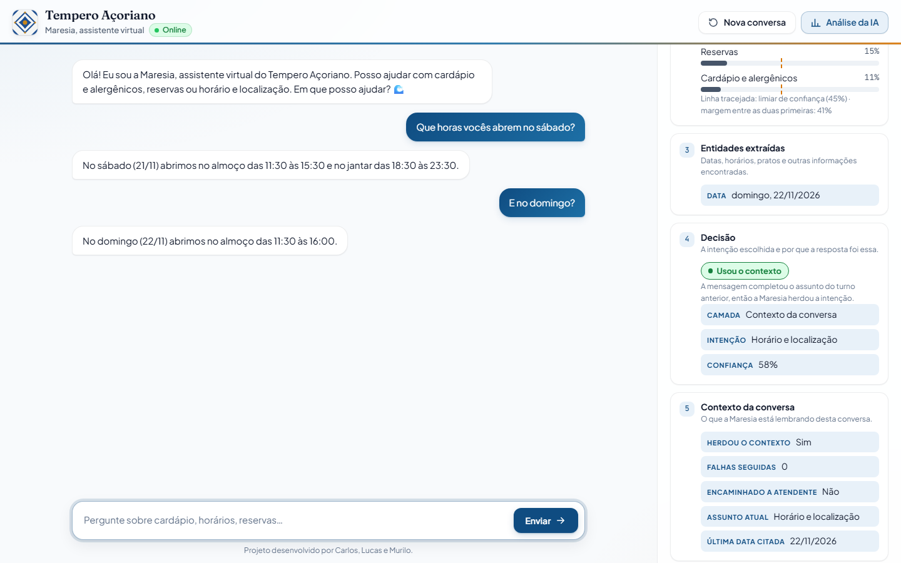
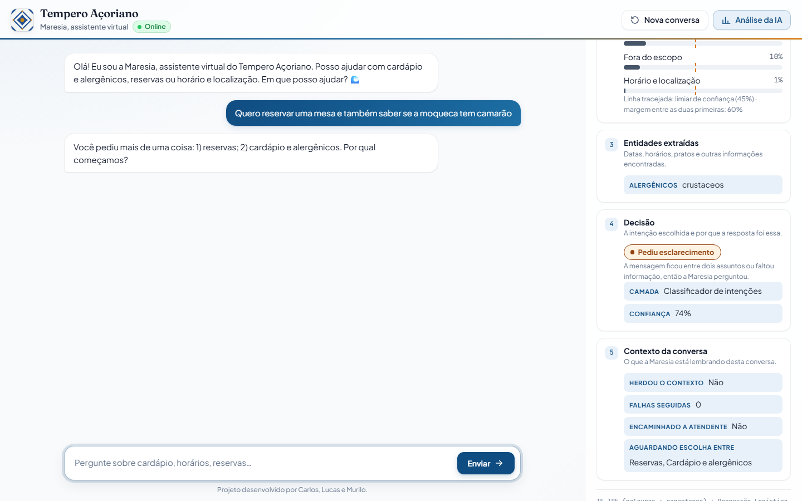
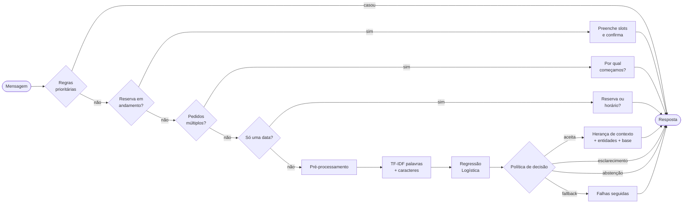
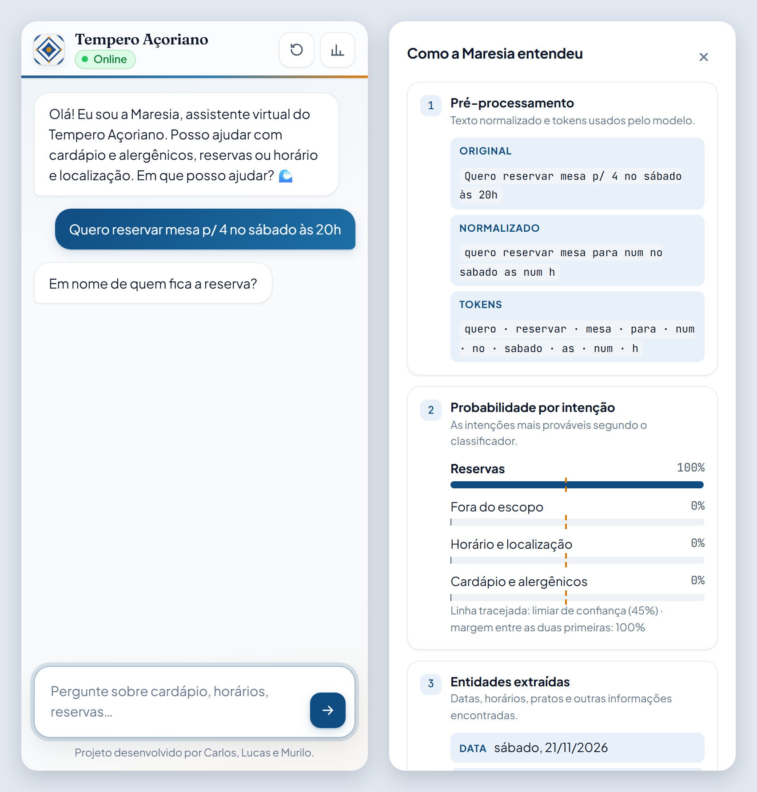

# Maresia — a assistente virtual do Tempero Açoriano

[](https://github.com/LucasdaCosta04/maresia-chatbot/actions/workflows/testes.yml)


A **Maresia** é a assistente virtual do **Tempero Açoriano**, um restaurante fictício de frutos do mar em
Santo Antônio de Lisboa, Florianópolis/SC. Ela responde dúvidas sobre o cardápio e os alergênicos, conduz
uma reserva simulada e informa horário e localização. Para isso, usa um classificador de intenções treinado
com scikit-learn, um extrator de entidades baseado em regras e uma base de conhecimento em JSON.

Projeto desenvolvido para a **A3 | Projeto Integrador de Inteligência Artificial**.



---

## O que a Maresia faz

### Intenções

O classificador reconhece quatro intenções. Elas estão em `dados/intencoes_treino.csv`, com 59 frases cada.

| Intenção | O que cobre | Exemplos de mensagem |
|---|---|---|
| `cardapio_alergenicos` | Pratos, preços, restrições (sem glúten, sem lactose, vegetariano, vegano) e alergênicos de cada prato | "A moqueca leva camarão?", "Vocês têm opção sem glúten?" |
| `reserva` | Reserva guiada: coleta pessoas, data, horário e nome, valida as regras e pede confirmação | "Quero reservar uma mesa", "Mesa p/ 4 no sábado às 20h" |
| `horario_localizacao` | Horário de funcionamento (inclusive de um dia específico), endereço e como chegar | "Que horas vocês abrem no sábado?", "Onde fica o restaurante?" |
| `fora_escopo` | Assuntos sem relação com o restaurante | "Qual a previsão do tempo?" |

### Comportamentos de diálogo

- **Regras prioritárias:** pedido de atendente, cancelar, ajuda, saudação e despedida são reconhecidos antes
  do classificador e recebem uma resposta fixa.
- **Herança de contexto:** depois de "Que horas vocês abrem no sábado?", a mensagem "E no domingo?" é
  respondida com o horário de domingo (veja a captura acima).
- **Pedidos múltiplos:** "Quero reservar uma mesa e também saber se a moqueca tem camarão" vira
  "Você pediu mais de uma coisa: 1) reservas; 2) cardápio e alergênicos. Por qual começamos?".
- **Data solta:** uma mensagem só com a data ("sábado") leva a Maresia a perguntar se a pessoa quer
  reservar ou saber o horário daquele dia.
- **Esclarecimento:** quando a mensagem é do domínio, mas o modelo hesita entre duas intenções, a Maresia
  pergunta em vez de chutar.
- **Abstenção:** se a intenção mais provável é `fora_escopo`, a Maresia recusa com educação.
- **Fallback e encaminhamento humano:** quando nada se destaca, a Maresia diz que não entendeu e sugere os
  assuntos que conhece. Depois de **2 falhas seguidas**, ou se a pessoa pedir, encaminha a conversa para um
  atendente. O contador de falhas volta a zero quando uma mensagem é entendida.



---

## Como a IA funciona



1. **Pré-processamento** (`chatbot/preprocessamento.py`): minúsculas, remoção de acentos, expansão de
   abreviações de chat (`vc`, `p/`, `hj`, `pra`…), números trocados pelo token `num` e pontuação e emojis
   removidos. Assim, "Mesa p/ 4 às 20h!!" vira `mesa para num as num h`. As stopwords são mantidas: na
   validação cruzada, removê-las piorou a acurácia.
2. **Classificador** (`chatbot/modelo.py`): um TF-IDF de palavras (1–2-gramas) e um de caracteres
   (2–5-gramas, que tolera erros de digitação) alimentam uma Regressão Logística com classes balanceadas.
3. **Política de decisão:**
   - **aceita** quando a confiança é ≥ **0,45** e a margem para a 2ª intenção é ≥ **0,15**;
   - **abstenção** quando a mais provável é `fora_escopo`;
   - **esclarecimento** quando as duas primeiras intenções de domínio somam ≥ 0,70 e a 2ª tem ≥ 0,20;
   - **fallback** nos demais casos.
4. **Entidades** (`chatbot/entidades.py`): pratos, alergênicos, restrições, número de pessoas, data (inclusive
   relativa: "amanhã", "sábado"), horário, período do dia e nome. Elas detalham as respostas e preenchem a
   reserva.
5. **Resposta** (`chatbot/dialogo.py`): monta o texto a partir da base `dados/base_conhecimento.json`
   (cardápio, funcionamento, regras de reserva e respostas fixas de cada intenção).

### Onde está cada parte no código

| Parte | Arquivo | Responsabilidade |
|---|---|---|
| Configuração | `chatbot/config.py` | Limiares, parâmetros do modelo, caminhos e fuso horário |
| Pré-processamento | `chatbot/preprocessamento.py` | Normalização do texto para o classificador |
| Classificador | `chatbot/modelo.py` | Pipeline TF-IDF + Regressão Logística, política de decisão e pedidos múltiplos |
| Entidades | `chatbot/entidades.py` | Extração de pratos, alergênicos, restrições, pessoas, data, horário e nome |
| Diálogo | `chatbot/dialogo.py` | Regras, reserva, contexto, esclarecimento, fallback e encaminhamento |
| Treino | `treinar.py` | Validação cruzada, relatório e gravação do modelo |
| API e interface | `app.py`, `templates/`, `static/` | Servidor Flask, página do chat e painel de explicabilidade |
| Dados de treino | `dados/intencoes_treino.csv` | Frases rotuladas (`frase,intencao`) |
| Base de conhecimento | `dados/base_conhecimento.json` | Restaurante, funcionamento, reserva, cardápio, alergênicos e respostas |

---

## Como executar

### Pré-requisitos

- **Python 3.10+** (o CI testa 3.10 e 3.13)
- Git

### Instalação

**Windows (PowerShell)**

```powershell
git clone https://github.com/LucasdaCosta04/maresia-chatbot.git
cd maresia-chatbot
python -m venv .venv
.\.venv\Scripts\Activate.ps1
pip install -r requirements.txt
```

**Linux / macOS**

```bash
git clone https://github.com/LucasdaCosta04/maresia-chatbot.git
cd maresia-chatbot
python3 -m venv .venv
source .venv/bin/activate
pip install -r requirements.txt
```

### 1. Treinar o modelo

```bash
python treinar.py
```

O script mostra a contagem por intenção, a validação cruzada estratificada (5 folds), o relatório por
intenção e a matriz de confusão. Depois, treina com o dataset inteiro e salva
`modelos/classificador.joblib`. O modelo não é versionado, então rode este passo antes do primeiro uso.

### 2. Rodar a API e a interface

```bash
python app.py                  # http://127.0.0.1:5000
```

Para ligar o modo debug, use `FLASK_DEBUG=1 python app.py` (no PowerShell: `$env:FLASK_DEBUG=1; python app.py`).
Se o modelo ainda não foi treinado, o servidor sobe mesmo assim e as rotas de mensagem respondem **503**.

### 3. Rodar os testes

```bash
python -m pytest -q
```

São 325 testes em `testes/`, cobrindo pré-processamento, entidades, modelo, diálogo, treino, API e
interface web. Eles treinam um modelo próprio em memória e não dependem de `modelos/`.

### 4. Capturar as telas (opcional)

```bash
pip install -r requirements-dev.txt
python -m playwright install chromium
python docs/capturar_telas.py
```

O script sobe um servidor próprio com data fixa (18/11/2026) e respostas com semente fixa, então as
imagens saem sempre iguais. Ele abre o Chromium headless e grava `docs/tela_contexto.png`,
`docs/tela_dois_pedidos.png` e `docs/tela_celular.png`. Antes de cada captura, confere que a página não tem
rolagem horizontal nem vertical. Para usar um servidor que já está rodando, passe `--conectar` (e `--url`,
se não for `http://127.0.0.1:5000`). Nesse caso as respostas seguem o relógio real.

### Scripts de checagem dos dados

```bash
python scripts/checar_dataset.py   # valida dados/intencoes_treino.csv
python scripts/checar_base.py      # valida dados/base_conhecimento.json
```

---

## Interface web

A página tem o chat com sugestões de mensagem e o painel **"Como a Maresia entendeu"**, que mostra, para a
última mensagem:

1. **Pré-processamento:** texto original, normalizado e tokens;
2. **Probabilidade por intenção:** barras com a linha do limiar de confiança;
3. **Entidades extraídas;**
4. **Decisão:** emblema, camada que respondeu, intenção e confiança;
5. **Contexto da conversa:** assunto atual, etapa e dados da reserva, falhas seguidas e outros dados da sessão.

No desktop, o painel fica ao lado do chat. Em telas de até 1080px, vira uma gaveta aberta pelo botão
"Análise da IA". O layout ocupa a altura da tela (`100dvh`): só a lista de mensagens e o painel rolam.



---

## API

| Rota | Corpo | Descrição |
|---|---|---|
| `POST /api/chat` (alias `POST /api/mensagem`) | `{"mensagem": "...", "sessao": "..."}` | Responde à mensagem. Sem `sessao`, ou com um id desconhecido, cria uma sessão nova e devolve o id |
| `POST /api/reiniciar` | `{"sessao": "..."}` | Limpa o estado da sessão e devolve a saudação |
| `GET /api/saude` | — | `status`, `modelo_carregado`, `sessoes_ativas`, `limiar`, `margem_minima` e `modelo` (metadados) |

A mensagem pode ter no máximo 500 caracteres. Erros vêm em JSON, como `{"erro": "...", "status": 400}`.

Exemplo de `POST /api/chat` com `{"mensagem": "Vocês abrem domingo?"}`, feito numa quarta-feira,
18/11/2026. Os campos `entidades`, `contexto` e `modelo` foram encurtados:

```json
{
  "resposta": "No domingo (22/11) abrimos no almoço das 11:30 às 16:00.",
  "intencao": "horario_localizacao",
  "tipo": "aceita",
  "decisao": "aceita",
  "confianca": 0.9709,
  "margem": 0.9584,
  "alternativas": [
    {"intencao": "horario_localizacao", "probabilidade": 0.9709},
    {"intencao": "cardapio_alergenicos", "probabilidade": 0.0125},
    {"intencao": "reserva", "probabilidade": 0.0113}
  ],
  "herdou_contexto": false,
  "encaminhado": false,
  "encaminhar_humano": false,
  "falhas_seguidas": 0,
  "sessao": "3f2a…",

  "texto_original": "Vocês abrem domingo?",
  "texto_normalizado": "voces abrem domingo",
  "tokens": ["voces", "abrem", "domingo"],
  "entidades": {"data": "2026-11-22", "dia_semana": "domingo", "pessoas": null, "horario": null},
  "limiar": 0.45,
  "margem_minima": 0.15,
  "probabilidades": {
    "cardapio_alergenicos": 0.0125, "fora_escopo": 0.0053,
    "horario_localizacao": 0.9709, "reserva": 0.0113
  },
  "contexto": {"assunto": "horario_localizacao", "etapa_reserva": null, "slots": {}, "falhas_seguidas": 0},
  "modelo": {"tipo": "TF-IDF (palavras + caracteres) + Regressão Logística", "intencoes": ["..."]}
}
```

`tipo` (e o alias `decisao`) pode ser `aceita`, `esclarecimento`, `abstencao`, `fallback`, `regra`,
`reserva` ou `encaminhamento`. As sessões ficam em memória e se perdem quando o servidor reinicia.

---

## Resultados

Saída de `python treinar.py`: validação cruzada estratificada com 5 folds sobre as 236 frases do dataset
e semente fixa.

| Métrica | Valor |
|---|---|
| Acurácia | **0,830 ± 0,043** |
| F1-macro | **0,827** |

A validação cruzada mede só o classificador. As regras, as entidades, a herança de contexto e os pedidos
múltiplos são avaliados pelos testes automatizados.

---

## Estrutura do projeto

```
maresia-chatbot/
├── .github/
│   ├── ISSUE_TEMPLATE/          # modelos de issue (erro, tarefa)
│   ├── pull_request_template.md
│   └── workflows/testes.yml     # CI: pytest em Python 3.10 e 3.13
├── chatbot/
│   ├── config.py                # limiares e parâmetros
│   ├── dialogo.py               # gerenciador de diálogo
│   ├── entidades.py             # extração de entidades
│   ├── modelo.py                # TF-IDF + Regressão Logística e política de decisão
│   └── preprocessamento.py      # normalização do texto
├── dados/
│   ├── base_conhecimento.json   # restaurante, cardápio, reserva e respostas
│   ├── intencoes_treino.csv     # frases de treino (frase,intencao)
│   └── LEIAME_dados.md          # origem e critérios dos dados
├── docs/
│   ├── capturar_telas.py        # gera as capturas com Playwright
│   ├── tela_contexto.png
│   ├── tela_dois_pedidos.png
│   └── tela_celular.png
├── modelos/                     # modelo treinado (.joblib, não versionado)
├── scripts/
│   ├── checar_base.py           # valida a base de conhecimento
│   └── checar_dataset.py        # valida o dataset
├── static/                      # styles.css e script.js da interface
├── templates/index.html         # página do chat
├── testes/                      # testes automatizados (pytest)
├── app.py                       # servidor Flask (API + interface)
├── treinar.py                   # treino e validação do modelo
├── requirements.txt             # dependências do projeto
├── requirements-dev.txt         # pytest e Playwright
├── CHANGELOG.md
├── CONTRIBUTING.md
├── LICENSE
└── README.md
```

---

## Desafio ao vivo: adicionar uma intenção nova sem mexer no código

As frases de treino ficam em `dados/intencoes_treino.csv` e as respostas em `dados/base_conhecimento.json`.
Para ensinar a Maresia a responder sobre **formas de pagamento**:

**1. Adicione as frases ao CSV** com o rótulo novo (use pelo menos 15 frases variadas):

```csv
vocês aceitam pix,pagamento
posso pagar com pix,pagamento
qual a chave pix,pagamento
formas de pagamento,pagamento
aceitam cartão de crédito,pagamento
posso pagar em dinheiro,pagamento
```

**2. Adicione a intenção à lista `intencoes` da base**, com as respostas:

```json
{
  "intencao": "pagamento",
  "frases": [],
  "respostas_fixas": [
    "Aceitamos PIX, cartões de crédito e débito e dinheiro. 🌊"
  ]
}
```

**3. Treine de novo e suba o servidor:**

```bash
python treinar.py
python app.py
```

Mensagens como "aceita pix?" passam a ser respondidas pela intenção nova, sem nenhum `.py` alterado. O
painel mostra a nova barra de probabilidade.

> Os temas de pagamento estão reservados para este desafio. Por isso, `scripts/checar_dataset.py` e
> `scripts/checar_base.py` apontam esse conteúdo como erro, e o rótulo novo não está na lista de rótulos
> permitidos do checador.

---

## Parâmetros (`chatbot/config.py`)

| Parâmetro | Valor | Efeito |
|---|---|---|
| `LIMIAR_CONFIANCA` | `0.45` | Probabilidade mínima para aceitar uma intenção |
| `MARGEM_MINIMA` | `0.15` | Diferença mínima entre a 1ª e a 2ª intenção para aceitar |
| `SOMA_ESCLARECIMENTO` | `0.70` | Soma mínima das duas primeiras intenções de domínio para pedir esclarecimento |
| `MIN_SEGUNDA_ESCLARECIMENTO` | `0.20` | Probabilidade mínima da 2ª intenção no esclarecimento |
| `MAX_FALHAS_SEGUIDAS` | `2` | Falhas seguidas antes de encaminhar para um atendente |
| `MIN_PALAVRAS_PEDIDO` | `2` | Tamanho mínimo de um trecho para contar como pedido separado |
| `NGRAM_PALAVRAS` / `NGRAM_CARACTERES` | `(1, 2)` / `(2, 5)` | Faixas de n-gramas do TF-IDF |
| `C_REGULARIZACAO` | `10` | Inverso da regularização da Regressão Logística |
| `FOLDS_VALIDACAO` | `5` | Folds da validação cruzada em `treinar.py` |
| `MAX_CARACTERES_MENSAGEM` | `500` | Tamanho máximo de uma mensagem na API |
| `FUSO_HORARIO` | `America/Sao_Paulo` | Fuso usado para datas relativas e para as regras de reserva |

Um limiar maior deixa a Maresia mais cautelosa: mais esclarecimentos e fallbacks, menos respostas erradas.
Um limiar menor faz o contrário.

---

## Limitações conhecidas

- **Dataset pequeno:** 236 frases (59 por intenção). A acurácia de validação cruzada fica em torno de 83%, e
  frases muito diferentes das de treino podem cair em esclarecimento ou fallback.
- **Reserva simulada:** a reserva é validada e confirmada, mas não é gravada em banco de dados nem enviada a
  uma agenda.
- **Sessões em memória:** cada sessão tem estado próprio, mas tudo se perde quando o servidor reinicia, e não
  há limpeza automática de sessões antigas.
- **Entidades por regras:** datas, horários e nomes são reconhecidos por padrões fixos. Formas pouco comuns
  podem não ser entendidas.
- **Dados fictícios:** restaurante, endereço, cardápio, preços e horários foram inventados para fins acadêmicos.
- **Só português:** o pré-processamento, as entidades e os dados são em português do Brasil.

---

## Equipe

| Integrante | Papel |
|---|---|
| Carlos | _a definir_ |
| Murilo | _a definir_ |
| Lucas | _a definir_ |

---

## Uso de IA generativa

Durante o desenvolvimento, a equipe usou o **Claude, da Anthropic**, como apoio para revisar código,
sugerir casos de teste e redigir a documentação. Todo conteúdo gerado foi lido, testado e ajustado pela
equipe, que se responsabiliza pelo resultado final. O classificador da Maresia **não** usa nenhum modelo de
linguagem generativo: roda inteiramente com scikit-learn e com os dados deste repositório.

---

## Licença

- **Código:** [MIT](LICENSE). © 2026 Equipe Maresia: Carlos, Lucas e Murilo.
- **Dados** (pasta `dados/`): [Creative Commons Atribuição 4.0 Internacional (CC BY 4.0)](https://creativecommons.org/licenses/by/4.0/deed.pt_BR).
